<a id="top"></a>

<picture>
  <source media="(prefers-color-scheme: dark)" srcset="docs/assets/hero-dark.webp">
  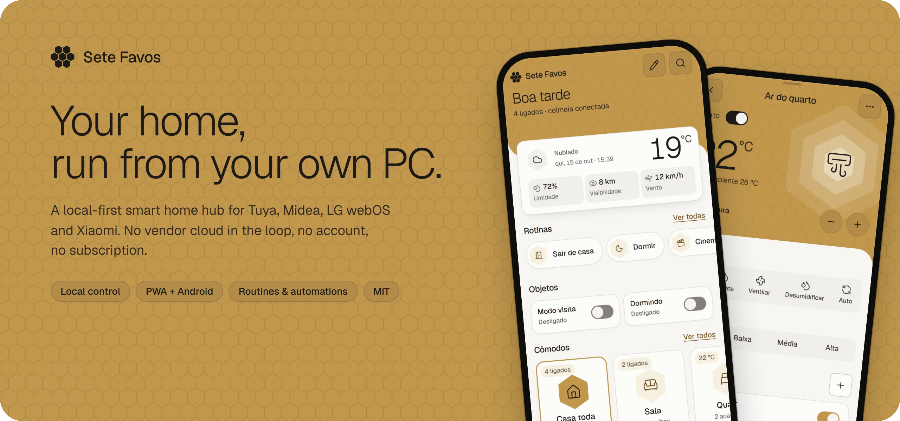
</picture>

<p align="center">
  <a href="https://github.com/Yanngc32/Sete-Favos/releases/latest"></a>
  <a href="LICENSE"></a>
  
  
  
</p>

<p align="center">
  <a href="#see-it-in-action">Demo</a> ·
  <a href="#features">Features</a> ·
  <a href="#works-with">Devices</a> ·
  <a href="#how-it-works">How it works</a> ·
  <a href="#try-it-in-two-minutes">Try it</a> ·
  <a href="#install-on-your-home-pc">Install</a> ·
  <a href="#contributing">Contributing</a> ·
  <a href="README.pt-BR.md">Português</a>
</p>

---

**Sete Favos** ("seven honeycombs") turns the Windows PC that already stays on at home into the hub of your smart
home. It talks to plugs, bulbs, air conditioners, TVs and robot vacuums **directly over your network**, so turning a
light on doesn't make a round trip through a vendor's server on another continent. You get one fast dashboard for
every brand, on any phone or browser, plus routines, automations and an Android home-screen widget.

No account to create, no subscription, no telemetry. Your device keys stay on your PC.

> [!NOTE]
> The interface is in **Brazilian Portuguese** today. The code, comments and docs are being opened up for everyone;
> translations are a welcome first contribution.

## See it in action

<p align="center">
  <a href="docs/assets/video/mobile-tour.mp4">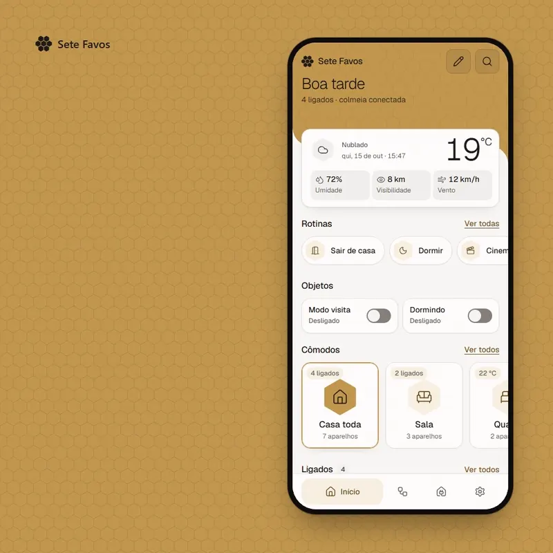</a>
</p>

<p align="center">
  <a href="docs/assets/video/desktop-tour.mp4">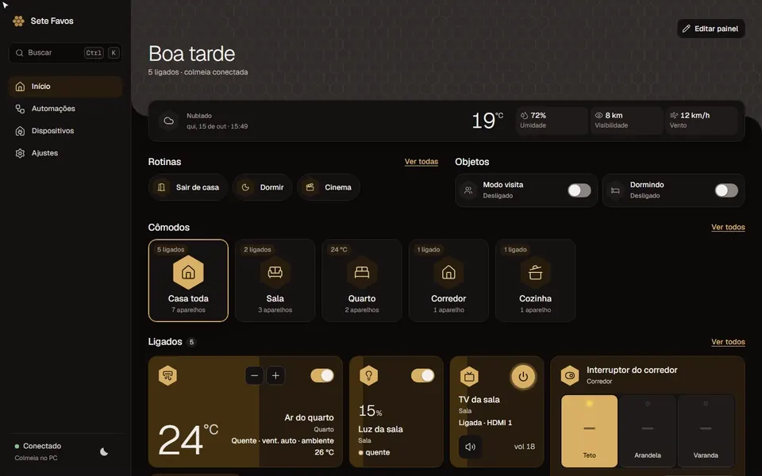</a>
</p>

<p align="center"><sub>Recorded from the built-in demo mode, no real devices needed. Click a clip for the full-quality MP4.</sub></p>

## Features

<p align="center">
  <picture><source media="(prefers-color-scheme: dark)" srcset="docs/assets/feature-local-dark.webp">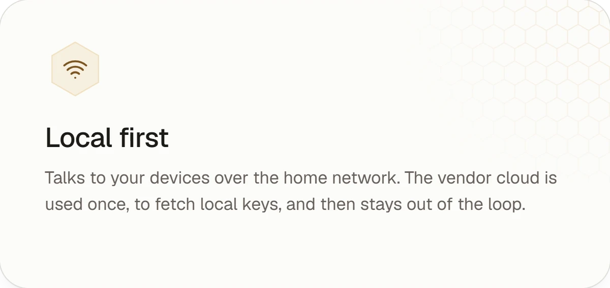</picture>
  <picture><source media="(prefers-color-scheme: dark)" srcset="docs/assets/feature-automations-dark.webp">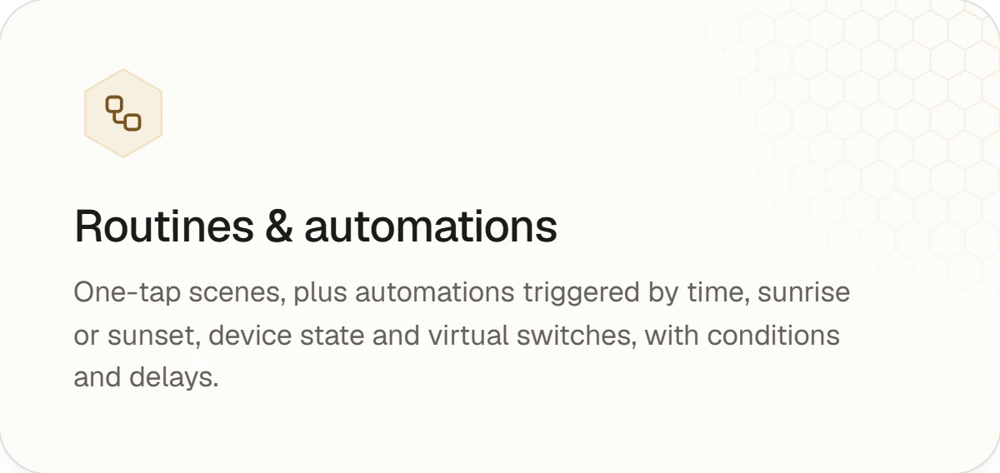</picture>
  <picture><source media="(prefers-color-scheme: dark)" srcset="docs/assets/feature-android-dark.webp">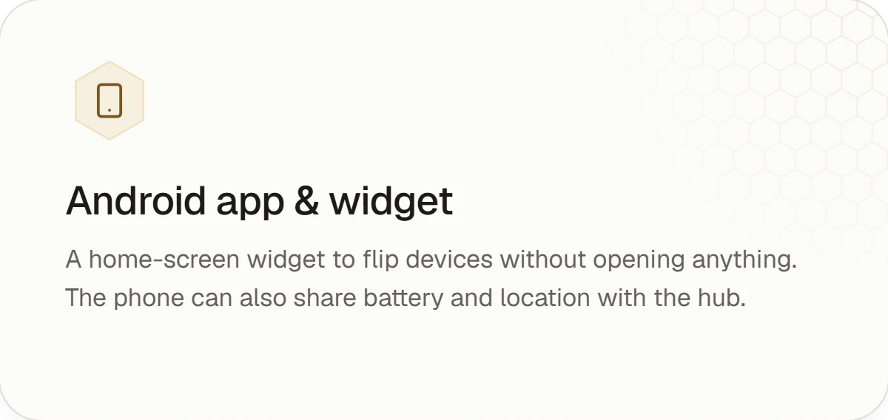</picture>
  <picture><source media="(prefers-color-scheme: dark)" srcset="docs/assets/feature-secure-dark.webp">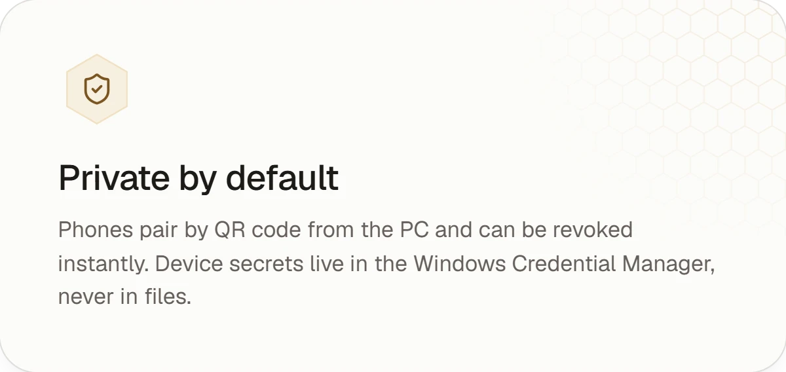</picture>
  <picture><source media="(prefers-color-scheme: dark)" srcset="docs/assets/feature-remote-dark.webp">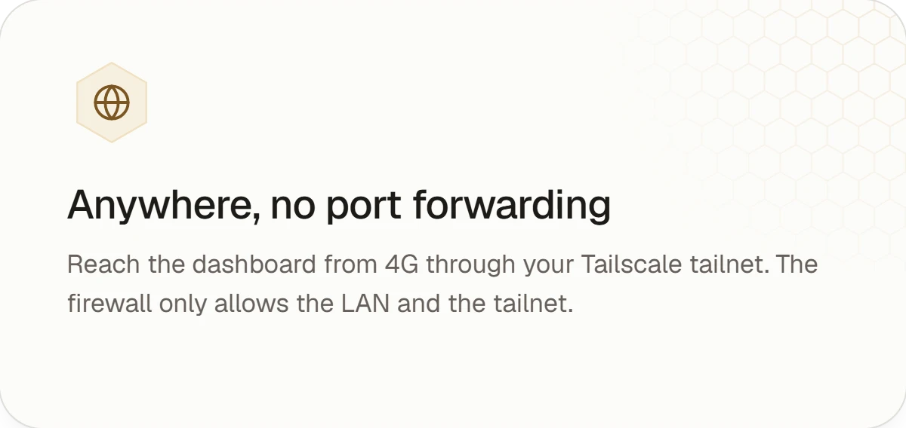</picture>
  <picture><source media="(prefers-color-scheme: dark)" srcset="docs/assets/feature-dashboard-dark.webp">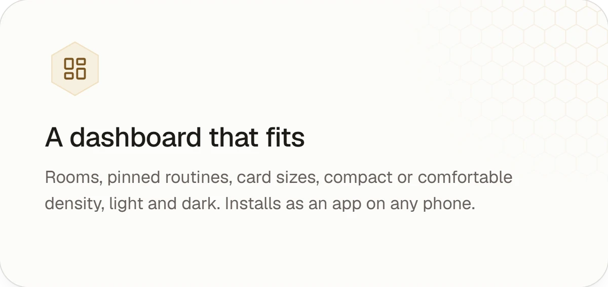</picture>
</p>

<details>
<summary><b>Everything in the box</b></summary>

- **Dashboard (PWA)**: home screen with weather, scenes, virtual switches, rooms and what's on; per-device detail
  pages with schedules; search; light and dark themes; compact or comfortable density; per-card sizes and options.
- **Routines**: a list of actions you run with one tap, from the app, the widget or an automation.
- **Automations**: triggers (time, sunrise/sunset, device state, virtual switch), conditions (time window,
  weekday, device state, virtual switch) and actions (set a device, flip a virtual switch, wait, run a routine).
- **Device schedules**: "AC at 23 °C every night at 22:30" straight from the device page.
- **Groups and rooms**: control a room or a custom group as one.
- **Android app**: home-screen widget, plus battery and location so the phone works as a presence sensor.
- **Access control**: the PC is the admin; every other device pairs by QR and can be revoked at any time.
- **Auto-update**: the installed hub checks GitHub releases, verifies the SHA-256, backs up its database, installs
  and rolls back if the new version doesn't come up healthy.
- **Diagnostics**: `casa-diag` listens to the network and reports what it can find before you install anything.

</details>

## Works with

<picture>
  <source media="(prefers-color-scheme: dark)" srcset="docs/assets/integrations-dark.webp">
  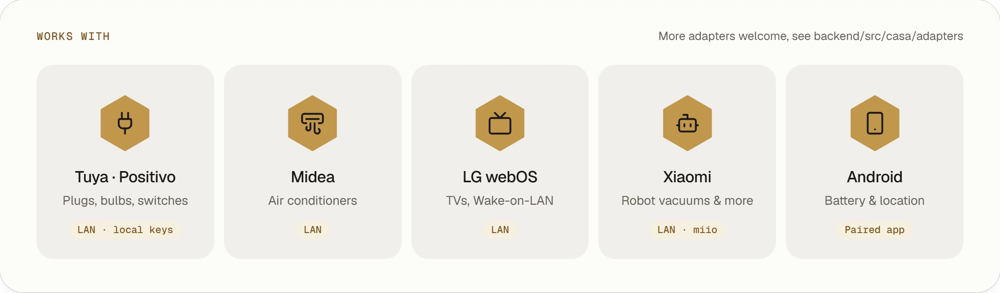
</picture>

| Brand | Devices | How it talks | One-time setup |
|---|---|---|---|
| **Tuya / Positivo** | plugs, bulbs, light strips, wall switches | LAN (UDP 6666/6667) with local keys | Tuya IoT project to fetch the keys once |
| **Midea** | air conditioners | LAN | optional Midea account to read the token |
| **LG webOS** | TVs | LAN WebSocket, Wake-on-LAN to power on | accept the pairing prompt on the TV |
| **Xiaomi** | robot vacuums and other miio devices | LAN (miio) | Mi account to read the device token |
| **Android** | your phone | the paired Sete Favos app | scan the QR code from the PC |

Missing your brand? Adapters are small and self-contained. See [Contributing](#contributing).

## How it works

<picture>
  <source media="(prefers-color-scheme: dark)" srcset="docs/assets/architecture-dark.webp">
  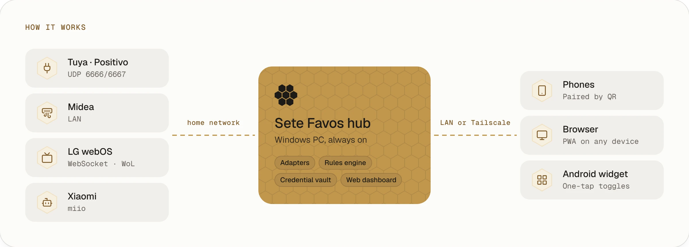
</picture>

- **The hub** is a Python 3.13 service (FastAPI + asyncio) that runs as a Windows scheduled task under SYSTEM. It
  starts at boot, before anyone logs in, and restarts itself if it crashes.
- **Adapters** speak each vendor's local protocol. The rules engine runs routines, automations and schedules, and a
  WebSocket pushes every state change to all open dashboards in real time.
- **Secrets** (Tuya keys, tokens, TV client keys) go to the Windows Credential Manager. The API never returns a secret.
- **The firewall** only lets the LAN and your Tailscale tailnet reach the dashboard. Tuya's UDP ports are LAN-only.

## Screenshots

<picture>
  <source media="(prefers-color-scheme: dark)" srcset="docs/assets/gallery-dark.webp">
  
</picture>

<picture>
  <source media="(prefers-color-scheme: dark)" srcset="docs/assets/desktop-dark.webp">
  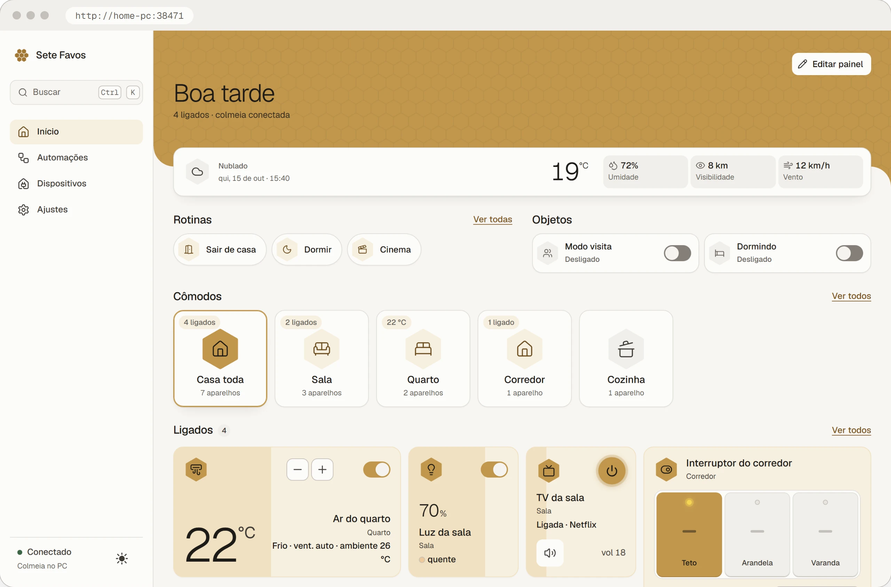
</picture>

<p align="center"><sub>The README follows your GitHub theme: switch between light and dark to see both looks.</sub></p>

## Try it in two minutes

The demo mode simulates a whole house (lights, AC, TV, wall switch, robot vacuum) so you can explore everything
without owning a single device. You need [uv](https://docs.astral.sh/uv/) and Node 20+.

```bash
git clone https://github.com/Yanngc32/Sete-Favos.git && cd Sete-Favos
cd frontend && npm ci && npm run build && cd ..
cd backend && uv sync
CASA_SIMULAR=1 CASA_DATA_DIR=.demo uv run casa     # starts the simulated hub
uv run casa-demo                                   # in another terminal: fills in the sample house
```

Open <http://localhost:38471>. On PowerShell, set the variables with `$env:CASA_SIMULAR=1; $env:CASA_DATA_DIR=".demo"`.

To work on the dashboard with hot reload, keep the hub running and use `cd frontend && npm run dev`.

## Install on your home PC

1. On the PC that stays on, run the diagnostics to see what's on your network (read-only, nothing is changed):
   ```powershell
   cd backend; uv sync; uv run casa-diag
   ```
2. Download **`CentralSetup-x.y.z.exe`** from the [latest release](https://github.com/Yanngc32/Sete-Favos/releases/latest)
   and run it. The installer sets up the data folder, firewall rules, power settings, Tailscale (if installed) and
   the startup task, then opens the dashboard.
3. On the PC, open **Ajustes → Acesso → Parear novo aparelho** and scan the QR code with each phone.
4. Add your devices from **Dispositivos → +**.

Prefer running from source? [ops/README.md](ops/README.md) covers the script-based install, the acceptance test and
where every file lives.

**Remote access**: install [Tailscale](https://tailscale.com) on the PC and on your phones, then open
`http://<pc-name>:38471` from anywhere. Don't expose the port to the internet and don't put a local TCP proxy in
front of it: the hub treats requests coming from the PC itself as the admin.

**Android app**: build it from `android/` with Gradle (`./gradlew assembleRelease`). Releases that are signed with
the project keystore also ship the APK, and the hub offers it for download under Ajustes.

## Project layout

```
backend/        the hub: adapters, rules engine, access control, vault, updater (Python 3.13, FastAPI)
  src/casa/adapters/   one module per vendor, all implementing adapters/base.py
frontend/       the dashboard (React 19, Vite, Tailwind 4), installable as a PWA
android/        the Android app and home-screen widget (Kotlin)
packaging/      PyInstaller spec, Inno Setup installer and its setup script
ops/            script-based install, uninstall and runbook
docs/           README media and the kit that regenerates it
```

## Development

```bash
cd backend && uv run pytest && uvx ruff check src tests
cd frontend && npm test && npm run typecheck
```

Releases are automatic: bump `version` in `backend/pyproject.toml` on `main` and CI tags it, runs the tests,
builds `central.exe`, the installer and its SHA-256, and publishes the release.

The images and clips in this README are generated from the demo hub by [docs/readme-kit](docs/readme-kit), using
the same design tokens as the app. Run the demo on port 38499, then `npm run shots && npm run cards && npm run videos`.

## Contributing

Issues and pull requests are welcome. Good first contributions:

- **A new adapter.** Subclass the contract in `backend/src/casa/adapters/base.py` (account fields, discovery,
  building a device from an IP, optional pairing, and a driver with capabilities), register it and add tests next
  to `backend/tests/test_adapters.py`. The UI builds controls from the capabilities, so most devices need no
  front-end work.
- **Translations.** The interface strings are in Portuguese today.
- **Bug reports** with the output of `casa-diag` (it contains no secrets).

Please keep the hub local-first: no new cloud dependency in the control path.

## Security

Phones get access only after pairing from the PC, and access can be revoked instantly. Pairing tokens are stored as
hashes, state-changing requests must come from the same origin, and device secrets never leave the Credential
Manager. Found a vulnerability? Please open an issue **without** exploit details and ask for a private contact.

## License

[MIT](LICENSE). Third-party components and their licenses are listed in [licenses/](licenses/).

<p align="right"><a href="#top">Back to top ↑</a></p>
