<a id="topo"></a>

<picture>
  <source media="(prefers-color-scheme: dark)" srcset="docs/assets/hero-pt-dark.webp">
  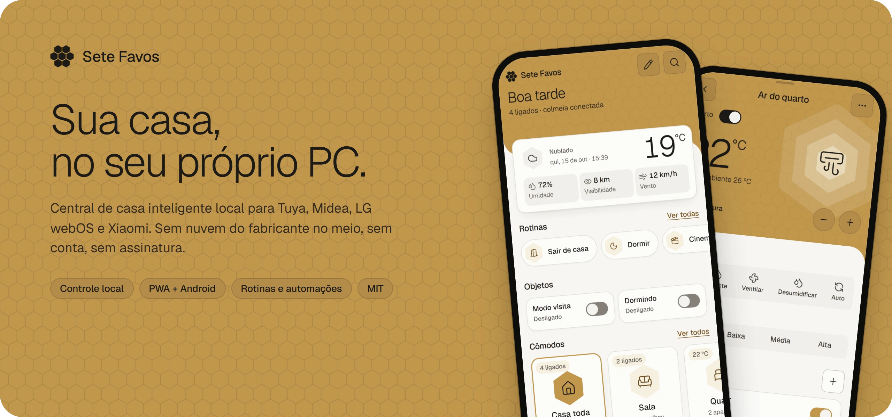
</picture>

<p align="center">
  <a href="https://github.com/Yanngc32/Sete-Favos/releases/latest"></a>
  <a href="LICENSE"></a>
  
  
  
</p>

<p align="center">
  <a href="#veja-funcionando">Demo</a> ·
  <a href="#recursos">Recursos</a> ·
  <a href="#aparelhos">Aparelhos</a> ·
  <a href="#como-funciona">Como funciona</a> ·
  <a href="#teste-em-dois-minutos">Testar</a> ·
  <a href="#instalar-no-pc-de-casa">Instalar</a> ·
  <a href="#como-contribuir">Contribuir</a> ·
  <a href="README.md">English</a>
</p>

---

O **Sete Favos** transforma o PC Windows que já fica ligado em casa na central da sua casa inteligente. Ele fala com
tomadas, lâmpadas, ar-condicionado, TV e robô aspirador **direto pela sua rede**: acender uma luz não precisa dar a
volta num servidor do fabricante do outro lado do mundo. Você ganha um painel rápido para todas as marcas, em
qualquer celular ou navegador, com rotinas, automações e widget na tela inicial do Android.

Sem conta para criar, sem assinatura, sem telemetria. As chaves dos seus aparelhos ficam no seu PC.

## Veja funcionando

<p align="center">
  <a href="docs/assets/video/mobile-tour-pt.mp4">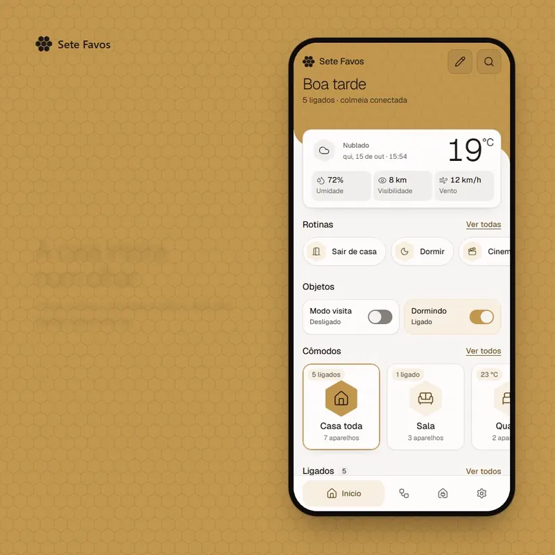</a>
</p>

<p align="center">
  <a href="docs/assets/video/desktop-tour.mp4"></a>
</p>

<p align="center"><sub>Gravado no modo demo, sem nenhum aparelho de verdade. Clique no vídeo para abrir o MP4 em qualidade cheia.</sub></p>

## Recursos

<p align="center">
  <picture><source media="(prefers-color-scheme: dark)" srcset="docs/assets/feature-local-pt-dark.webp">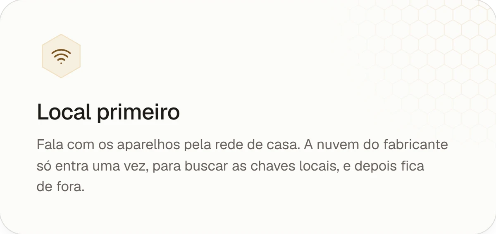</picture>
  <picture><source media="(prefers-color-scheme: dark)" srcset="docs/assets/feature-automations-pt-dark.webp">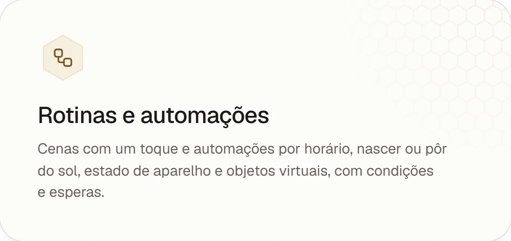</picture>
  <picture><source media="(prefers-color-scheme: dark)" srcset="docs/assets/feature-android-pt-dark.webp">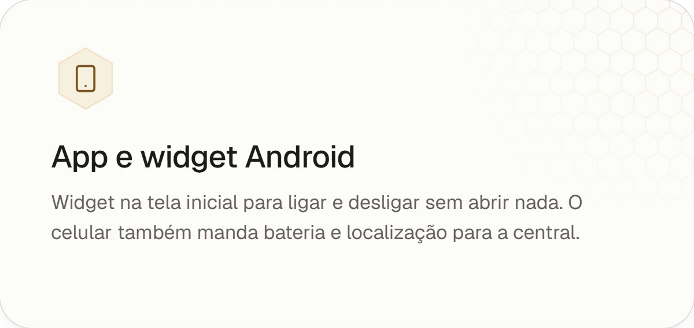</picture>
  <picture><source media="(prefers-color-scheme: dark)" srcset="docs/assets/feature-secure-pt-dark.webp">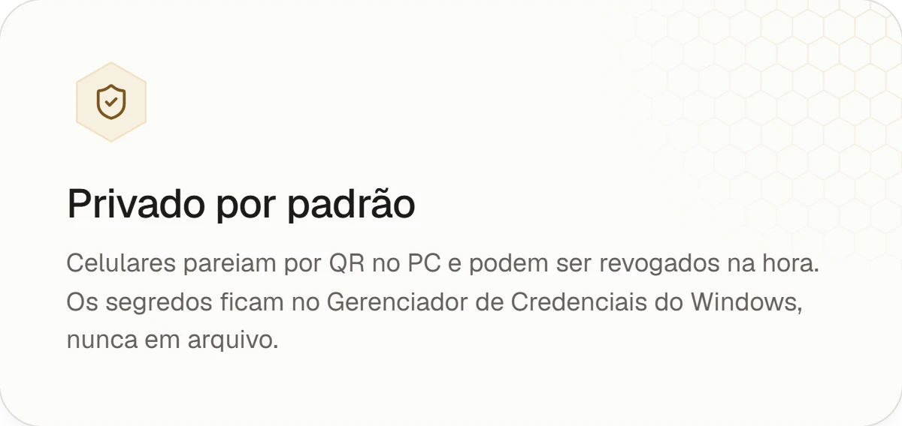</picture>
  <picture><source media="(prefers-color-scheme: dark)" srcset="docs/assets/feature-remote-pt-dark.webp">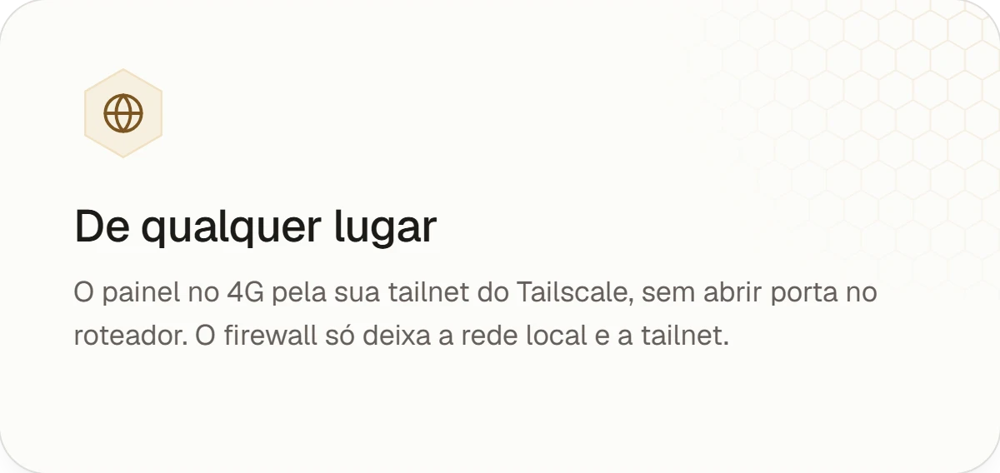</picture>
  <picture><source media="(prefers-color-scheme: dark)" srcset="docs/assets/feature-dashboard-pt-dark.webp">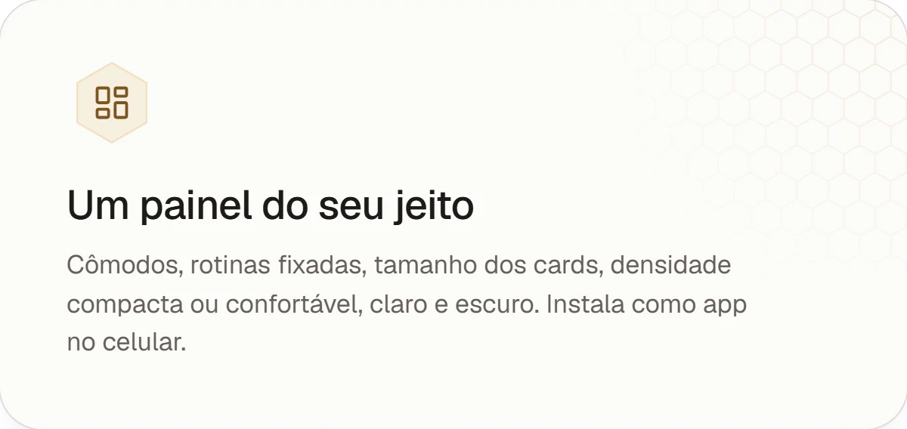</picture>
</p>

<details>
<summary><b>Tudo o que vem junto</b></summary>

- **Painel (PWA)**: Início com clima, rotinas, objetos virtuais, cômodos e o que está ligado; página de cada
  aparelho com horários; busca; tema claro e escuro; densidade compacta ou confortável; tamanho e opções por card.
- **Rotinas**: uma lista de ações que roda com um toque, pelo app, pelo widget ou por uma automação.
- **Automações**: gatilhos (horário, nascer/pôr do sol, estado de aparelho, objeto virtual), condições (faixa de
  horário, dia da semana, estado de aparelho, objeto virtual) e ações (ajustar aparelho, mudar objeto virtual,
  esperar, rodar rotina).
- **Horários por aparelho**: "ar em 23 °C todo dia às 22:30" direto na página do aparelho.
- **Grupos e cômodos**: comande um cômodo ou um grupo como se fosse um aparelho só.
- **App Android**: widget na tela inicial, e bateria e localização para o celular servir de sensor de presença.
- **Controle de acesso**: o PC é o administrador; qualquer outro aparelho pareia por QR e pode ser revogado.
- **Atualização automática**: a central instalada confere os releases do GitHub e o SHA-256, faz backup do banco,
  instala e volta para a versão anterior se a nova não subir.
- **Diagnóstico**: o `casa-diag` escuta a rede e mostra o que encontra antes de você instalar qualquer coisa.

</details>

## Aparelhos

<picture>
  <source media="(prefers-color-scheme: dark)" srcset="docs/assets/integrations-pt-dark.webp">
  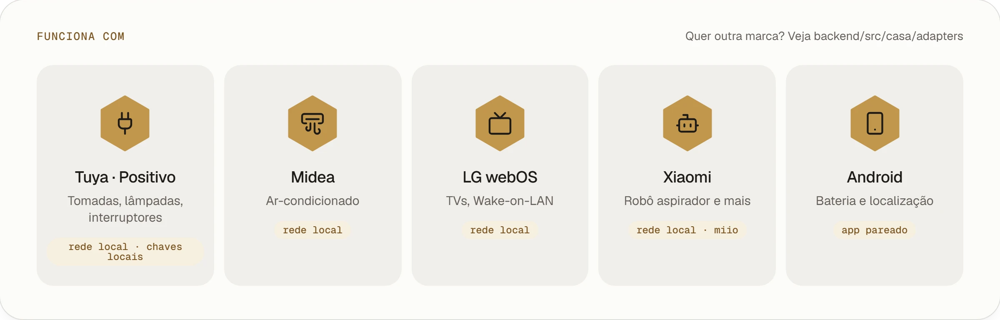
</picture>

| Marca | Aparelhos | Como conversa | Preparo (uma vez) |
|---|---|---|---|
| **Tuya / Positivo** | tomadas, lâmpadas, fitas de LED, interruptores | rede local (UDP 6666/6667) com chaves locais | projeto na Tuya IoT para buscar as chaves |
| **Midea** | ar-condicionado | rede local | conta Midea opcional para ler o token |
| **LG webOS** | TVs | WebSocket local, Wake-on-LAN para ligar | aceitar o pareamento na TV |
| **Xiaomi** | robô aspirador e outros aparelhos miio | rede local (miio) | conta Mi para ler o token |
| **Android** | seu celular | o app Sete Favos pareado | ler o QR no PC |

Sua marca não está aí? Os adaptadores são pequenos e independentes. Veja [Como contribuir](#como-contribuir).

## Como funciona

<picture>
  <source media="(prefers-color-scheme: dark)" srcset="docs/assets/architecture-pt-dark.webp">
  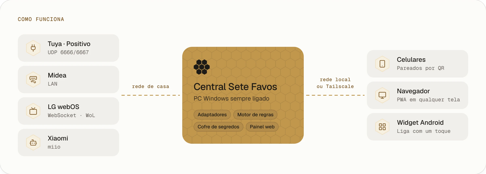
</picture>

- **A central** é um serviço Python 3.13 (FastAPI + asyncio) que roda como tarefa agendada do Windows na conta
  SYSTEM. Sobe no boot, antes de qualquer login, e se reinicia sozinha se cair.
- **Os adaptadores** falam o protocolo local de cada fabricante. O motor roda rotinas, automações e horários, e um
  WebSocket manda cada mudança de estado para todos os painéis abertos na hora.
- **Os segredos** (chaves Tuya, tokens, client key da TV) vão para o Gerenciador de Credenciais do Windows. A API
  nunca devolve um segredo.
- **O firewall** só deixa a rede local e a sua tailnet chegarem no painel. As portas UDP da Tuya ficam só na rede local.

## Telas

<picture>
  <source media="(prefers-color-scheme: dark)" srcset="docs/assets/gallery-pt-dark.webp">
  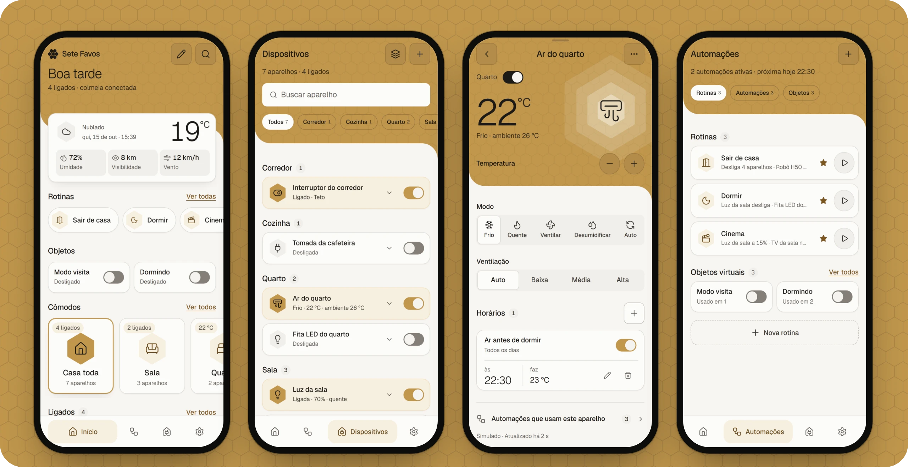
</picture>

<picture>
  <source media="(prefers-color-scheme: dark)" srcset="docs/assets/desktop-dark.webp">
  
</picture>

<p align="center"><sub>As imagens seguem o tema do seu GitHub: troque entre claro e escuro para ver os dois visuais.</sub></p>

## Teste em dois minutos

O modo demo simula uma casa inteira (luzes, ar, TV, interruptor, robô) para você explorar tudo sem ter nenhum
aparelho. Precisa de [uv](https://docs.astral.sh/uv/) e Node 20+.

```bash
git clone https://github.com/Yanngc32/Sete-Favos.git && cd Sete-Favos
cd frontend && npm ci && npm run build && cd ..
cd backend && uv sync
CASA_SIMULAR=1 CASA_DATA_DIR=.demo uv run casa     # sobe a central simulada
uv run casa-demo                                   # em outro terminal: monta a casa de exemplo
```

Abra <http://localhost:38471>. No PowerShell, defina as variáveis com `$env:CASA_SIMULAR=1; $env:CASA_DATA_DIR=".demo"`.

Para mexer no painel com recarga ao vivo, deixe a central rodando e use `cd frontend && npm run dev`.

## Instalar no PC de casa

1. No PC que fica ligado, rode o diagnóstico para ver o que tem na rede (só leitura, não muda nada):
   ```powershell
   cd backend; uv sync; uv run casa-diag
   ```
2. Baixe o **`CentralSetup-x.y.z.exe`** do [último release](https://github.com/Yanngc32/Sete-Favos/releases/latest)
   e rode. O instalador prepara a pasta de dados, o firewall, a energia, o Tailscale (se estiver instalado) e a
   tarefa de inicialização, e abre o painel no fim.
3. No PC, abra **Ajustes → Acesso → Parear novo aparelho** e leia o QR com cada celular.
4. Adicione seus aparelhos em **Dispositivos → +**.

Prefere rodar do código? O [ops/README.md](ops/README.md) explica a instalação por script, o teste de aceite e onde
fica cada arquivo.

**Acesso de fora de casa**: instale o [Tailscale](https://tailscale.com) no PC e nos celulares e abra
`http://<nome-do-pc>:38471` de qualquer lugar. Não exponha a porta na internet e não coloque proxy TCP local na
frente: a central trata pedido que sai do próprio PC como administrador.

**App Android**: compile a partir de `android/` com o Gradle (`./gradlew assembleRelease`). Releases assinados com a
chave do projeto também trazem o APK, e a central oferece o download em Ajustes.

## Estrutura

```
backend/        a central: adaptadores, motor de regras, acesso, cofre, atualizador (Python 3.13, FastAPI)
  src/casa/adapters/   um módulo por fabricante, todos seguindo adapters/base.py
frontend/       o painel (React 19, Vite, Tailwind 4), instalável como PWA
android/        o app Android e o widget (Kotlin)
packaging/      spec do PyInstaller, instalador Inno Setup e o script de setup
ops/            instalação por script, desinstalação e manual de operação
docs/           mídia do README e o kit que a gera de novo
```

## Desenvolvimento

```bash
cd backend && uv run pytest && uvx ruff check src tests
cd frontend && npm test && npm run typecheck
```

Os releases são automáticos: suba o `version` do `backend/pyproject.toml` na `main` e o CI cria a tag, roda os
testes, gera o `central.exe`, o instalador e o SHA-256, e publica o release.

As imagens e vídeos deste README saem da central demo pelo [docs/readme-kit](docs/readme-kit), com os mesmos tokens
de design do app. Rode a demo na porta 38499 e depois `npm run shots && npm run cards && npm run videos`.

## Como contribuir

Issues e pull requests são bem-vindos. Bons primeiros passos:

- **Um adaptador novo.** Implemente o contrato de `backend/src/casa/adapters/base.py` (campos da conta, descoberta,
  montar o aparelho pelo IP, pareamento opcional e um driver com capacidades), registre e escreva testes junto de
  `backend/tests/test_adapters.py`. O painel monta os controles a partir das capacidades, então a maioria dos
  aparelhos não precisa de nada no front.
- **Traduções.** Os textos da interface estão em português.
- **Relatos de bug** com a saída do `casa-diag` (ela não tem segredos).

Por favor, mantenha a central local: nada de nova dependência de nuvem no caminho do comando.

## Segurança

Celulares só acessam depois de pareados pelo PC, e o acesso pode ser revogado na hora. Os tokens de pareamento ficam
guardados como hash, pedidos que mudam estado precisam vir da mesma origem e os segredos dos aparelhos nunca saem do
Gerenciador de Credenciais. Achou uma falha? Abra uma issue **sem** detalhes de exploração e peça um contato privado.

## Licença

[MIT](LICENSE). Componentes de terceiros e suas licenças estão em [licenses/](licenses/).

<p align="right"><a href="#topo">Voltar ao topo ↑</a></p>
